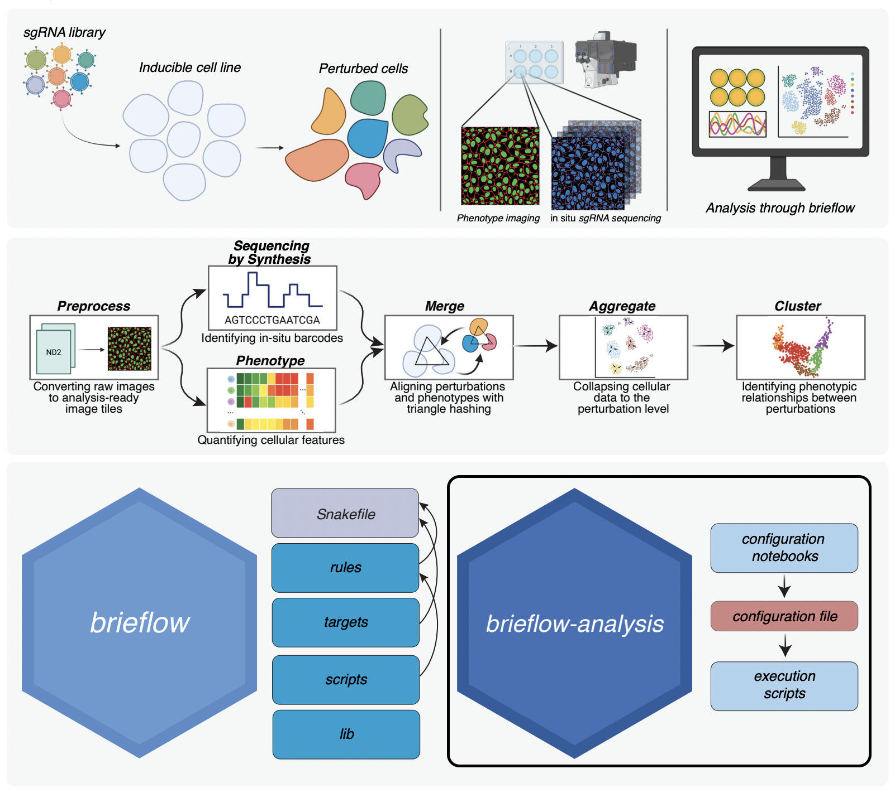

# Brieflow Analysis Template

Brieflow is an extensible computational pipeline for high-throughput analysis of optical pooled screening data.

This repo is a Github template with the configuration notebooks/files and execution scripts for running an OPS screen analysis.
[Brieflow](https://github.com/cheeseman-lab/brieflow) contains the source code for running an OPS screen analysis.

Each phase is configured in a [marimo](https://marimo.io) notebook (`analysis/0_preprocess.py` … `analysis/7_analyze.py`) and run with `bash analysis/flow.sh <module>`.
See [Running a Screen](https://brieflow.readthedocs.io/en/latest/3.running_modules.html) and [Working with the Notebooks](https://brieflow.readthedocs.io/en/latest/notebook_editor_setup.html).

## Example Screen Repositories

| Screen      | Repository                                             | Description                                      | Brieflow Version |
|-------------|--------------------------------------------------------|--------------------------------------------------|------------------|
| Denali      | [cheeseman-lab/denali-analysis](https://github.com/cheeseman-lab/denali-analysis)     | Original screen that drove Brieflow development | 1.0 |
| Aconcagua   | [cheeseman-lab/aconcagua-analysis](https://github.com/cheeseman-lab/aconcagua-analysis) | Re-analysis of Funk et al. 2022                 | 1.0 |

Examples use this template.
More examples coming soon. 
Please contact us if you have used Brieflow in your own analysis!

## Getting Started

We strongly suggest that Brieflow Analysis is set up with the companion [Brieflow](https://github.com/cheeseman-lab/brieflow) repository.

Full details on setup, installation, test data, usage, module details, and contribution guides:  
**https://brieflow.readthedocs.io**

### Starting a screen

1. Create a repository from this template and clone it with its submodule: `git clone --recurse-submodules <your-repo-url>`.
2. Create the conda environment and install Brieflow as described in the [Brieflow documentation](https://brieflow.readthedocs.io).
3. Fill in `analysis/screen.yaml` with the facts of your experiment (plates, wells, channels, cycles, library).
4. From `analysis/`, open the notebooks in order with `marimo edit <notebook>`; each writes its section of `config/config.yml`.
5. After each notebook, run its module with `bash flow.sh <module>` (add `--backend slurm` on a cluster), then open the next notebook.

| Notebook | Module | Run with |
|---|---|---|
| `0_preprocess.py` | preprocess | `bash flow.sh preprocess` |
| `1_sbs.py` | sbs | `bash flow.sh sbs` |
| `2_phenotype.py` | phenotype | `bash flow.sh phenotype` |
| `3_merge.py` | merge | `bash flow.sh merge` |
| `4_classify.py` | (no module; writes the classifier settings aggregate uses) | — |
| `5_aggregate.py` | aggregate | `bash flow.sh aggregate` |
| `6_cluster.py` | cluster | `bash flow.sh cluster` |
| `7_analyze.py` | mozzarellm (optional, calls a paid LLM API) | `bash flow.sh mozzarellm` |

`bash flow.sh --help` lists every option.
The [brieflow-auto](https://github.com/cheeseman-lab/brieflow-auto) Claude Code plugin can drive this template end to end: it fills the notebook parameters from `screen.yaml`, runs each module, and checks its QC.

## Contributing

We welcome community contributions to Brieflow!
Feel free to:
- Give [Brieflow](https://github.com/cheeseman-lab/brieflow) a star to boost its visibility!
- Join Brieflow's [Discord](https://discord.gg/yrEh6GP8JJ) to chat with the developers.
- File a [GitHub issue](https://github.com/cheeseman-lab/brieflow/issues) to share comments and issues. We aim to keep brieflow-related issues in the [main Brieflow repository](https://github.com/cheeseman-lab/brieflow/issues).
- Clone the repository, create a new branch, and submit a [pull request](https://github.com/cheeseman-lab/brieflow-analysis/compare).

Make sure to review the Brieflow [development guide](https://brieflow.readthedocs.io/en/latest/5.development.html) to understand how to best contribute!